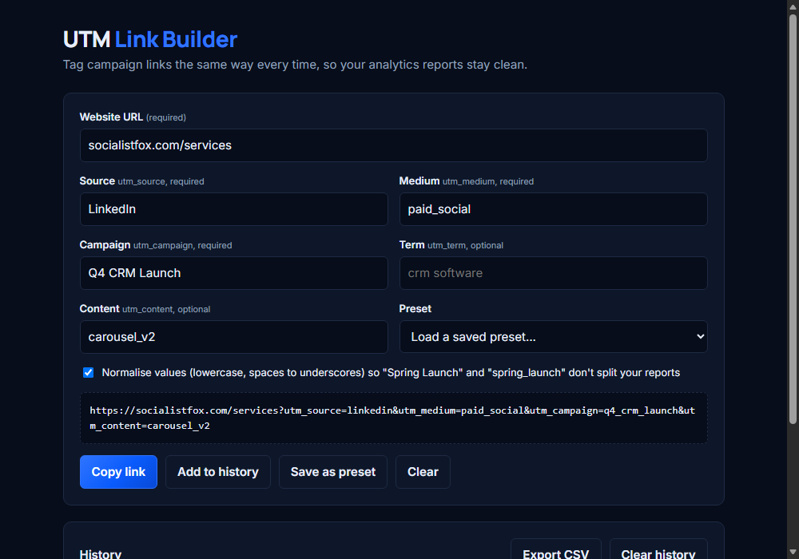

# UTM Link Builder

Build consistent UTM-tagged campaign links, save presets for each channel, and export everything to CSV. One HTML file, no sign-up, nothing leaves your browser.

**[Open the live tool →](https://socialistfox.github.io/utm-link-builder/)**

## Why

Analytics tools treat `LinkedIn`, `linkedin` and `linked_in` as three different sources. A few months of hand-typed links later, campaign reports are split across a dozen near-duplicate rows. This tool makes every link follow the same rules.

## Features

- **Normalised values**: lowercase, spaces to underscores, stray characters removed (can be switched off)
- **Required-field checks** for `utm_source`, `utm_medium` and `utm_campaign`
- **Presets**: save the source/medium/campaign combo for each channel and load it in one click
- **History**: keep the links you've built, copy them again, remove old ones
- **CSV export** of your history for a campaign tracking sheet
- **Shareable prefill**: pass fields in the query string to hand a teammate a half-filled builder:
  `?url=example.com/pricing&source=linkedin&medium=paid_social`
- Keeps any query parameters already on the URL
- Light and dark mode, works on mobile

## Use it

- **Online:** https://socialistfox.github.io/utm-link-builder/
- **Offline:** download `index.html` and open it in any browser

Presets and history are stored in your browser's `localStorage`. Clearing site data removes them.

## Self-host

It's a single static file. Drop `index.html` on any static host (GitHub Pages, Netlify, Vercel, S3) or inside your intranet.

## UTM cheat sheet

| Parameter | Use it for | Example |
|---|---|---|
| `utm_source` | Where the click came from | `linkedin`, `google`, `newsletter` |
| `utm_medium` | The type of channel | `paid_social`, `cpc`, `email` |
| `utm_campaign` | The campaign or promotion | `q4_crm_launch` |
| `utm_term` | Paid search keyword | `custom_crm` |
| `utm_content` | Which ad or link variant | `carousel_v2`, `header_cta` |

## License

MIT. See [LICENSE](LICENSE).

---

Built by **[Socialist Fox](https://www.socialistfox.com)**: custom software, AI automation and marketing technology for growing businesses. Need lead tracking or campaign reporting wired into your CRM? [Book a call](https://calendly.com/socialistfox).
